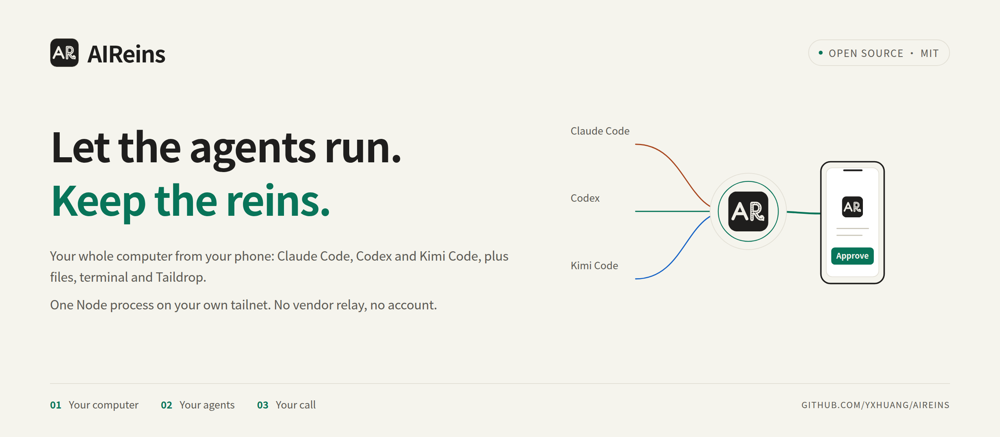
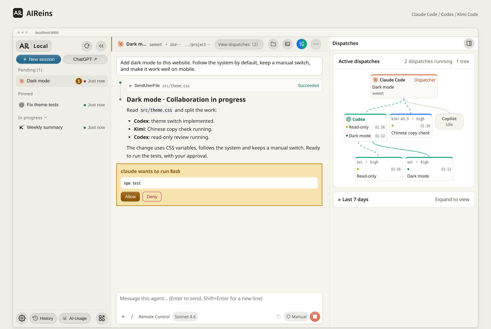
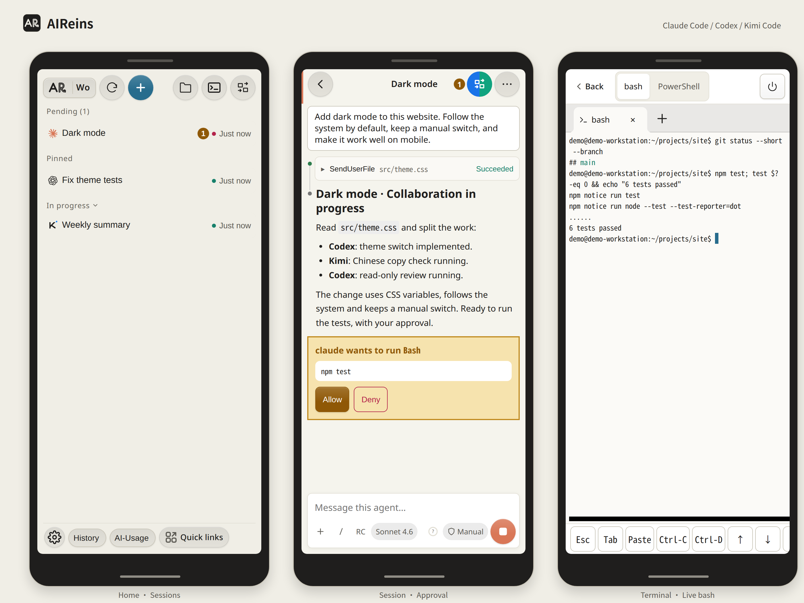
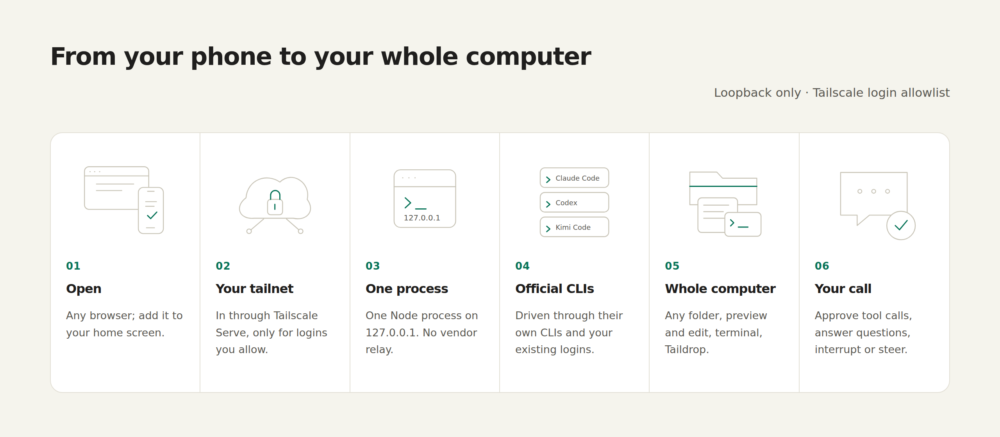

<p align="center">
  <picture>
    <source media="(prefers-color-scheme: dark)" srcset="docs/assets/banner-en-dark.png">
    
  </picture>
</p>

<p align="center">
  <a href="LICENSE"></a>
  
  
  
  
</p>

<p align="center">
  <b>Use your whole computer from your phone. Let three AI agents do the work; you set the direction.</b><br>
  One Node process and a web page, on your own private network.
</p>

<p align="center">
  <b>English</b> · <a href="README.zh-CN.md">简体中文</a>
</p>

<p align="center">
  <a href="https://yxhuang.github.io/AIReins/"><b>Website</b></a> ·
  <a href="#get-started">Get started</a> ·
  <a href="#remote-access-from-your-phone">Phone access</a> ·
  <a href="#how-it-works">How it works</a> ·
  <a href="#security">Security</a> ·
  <a href="CONTRIBUTING.md">Contributing</a>
</p>

<br>

## What it is

AIReins is an AI workbench that runs on your own computer. It drives Claude Code, Codex and Kimi Code through their official CLIs and your existing logins. You open sessions, approve tool calls, browse files and use a terminal from a browser on your desktop or phone, and reach the computer from anywhere over [Tailscale](https://tailscale.com).

Official remote options usually give you a window into one session. AIReins gives you the whole computer: any folder (including Windows drives under `/mnt/c`, not just git repos), file preview and editing, a terminal, sending with Taildrop, and the native history of all three CLIs.

## Highlights

- **Keeps your harness.** AIReins is not another agent framework. It drives the official Claude Code, Codex and Kimi Code CLIs you already have, so your `CLAUDE.md`, `AGENTS.md`, skills, hooks, MCP servers, plugins and CLI settings load as usual. Nothing to migrate, and AIReins never rewrites them on its own; only when you toggle the Claude Remote Control default or a Claude plugin in the UI is that saved to the matching native config. You can pick a model, reasoning effort and permission mode per session; the choice applies to that session only.
- **One workbench for all three.** No more switching between CLI windows: sessions from all three agents sit side by side, and approvals, answers and interrupts all happen in one place.
- **One history, free to come and go.** Search, filter by folder and resume the native history of all three CLIs in one place. Sessions live in each CLI's own history, so you can pick them up again in the CLI, the VS Code extension or the Codex app, and reach a Claude session from the Claude app once Remote Control is on. (For Claude sessions to appear in the CLI and VS Code history lists, set `claudeCodeEntrypoint` in `prefs.json`, see [Configuration](#configuration); without it, `claude --resume <session ID>` still works.)
- **Files and terminal at hand.** The right-hand panel holds a file window (browse any folder, preview, edit in place, see Git status) and a multi-tab terminal: your default shell (`$SHELL`) on Linux and macOS, bash plus Windows PowerShell under WSL.
- **A live dispatch map.** When one agent leads and hands work to the others, the dispatch flow chart shows who sent what to whom, how far each run has got and whether it passed; sub-agents unfold as a parent/child tree too.
- **Quick links and AI usage.** The Quick links menu holds your own links (web pages, `vscode://`, `obsidian://` and more, from one JSON file). An optional embedded [AI-Usage](https://github.com/yxhuang/ai-usage) panel shows the subscription quota of all three on one page; bars with a fixed time window also mark how much of that window has elapsed, so you can see at a glance whether you are spending faster than time. Turn on Tibo reset alerts in Settings (off by default) and AIReins checks [AIHOT](https://aihot.news/codex-reset) every 10 minutes for Tibo's Codex quota-reset announcements, alerting every open page and listing them at the bottom of the quota page.
- **The whole computer on your phone.** Connect back over Tailscale to approve, read files and open a terminal from your phone.

## A look

<picture>
  <source media="(prefers-color-scheme: dark)" srcset="docs/assets/desktop-en-dark.png">
  
</picture>

<picture>
  <source media="(prefers-color-scheme: dark)" srcset="docs/assets/mobile-en-dark.png">
  
</picture>

<p align="center"><sub>Screenshots from a local instance running on demo data; the sessions and paths are made up.</sub></p>

## Why "Reins"

Agents keep getting more capable. They read code, edit files, run commands and work through long task lists on their own. I still don't want to hand over the wheel entirely: what is worth doing, when a task is finished, which command may run and which conclusion doesn't hold up are judgments that belong to a person.

So everything in AIReins serves one idea: **let the agents run, and keep the reins in your hand.**

- **Decide from anywhere.** Approve or deny tool calls and answer the agents' questions from your phone. Everything waiting on you, across all sessions, is collected in one place.
- **Pull them back mid-run.** Interrupt with one tap; with Claude Code and Codex you can also steer a running turn or ask a side question (Kimi queues messages until the current turn ends), instead of waiting for the run to finish and redoing it.
- **See what they are doing.** Context usage and every tool call in plain view, with sub-agents and delegated runs laid out as a parent/child tree.
- **Use all three together.** Let one agent lead and hand work to another (with an external delegation tool, see [Optional integrations](#optional-integrations)) and follow the whole dispatch tree on your phone. You decide which agent suits which job; no single vendor locks you in.
- **Keep everything yours.** No vendor relay, no account, no telemetry. Sessions are the CLIs' own native history, so you can resume them from the command line or VS Code as usual.

## Before you start

- **I built this for myself.** I use it every day on Windows + WSL2, and much of its code was written inside it, together with these three agents. It is not a polished general-purpose product and it has rough edges. Issues are welcome; I may be slow to reply, and I apologise in advance.
- **Platforms.** Windows + WSL2 is the main platform. Native Linux is supported with required Ubuntu CI checks. macOS is experimental: I have no Mac, so it is tested only in CI. macOS reports are very welcome.
- **It grants access to the whole computer.** Anyone who can reach AIReins has the power of your user account on that machine. It therefore listens on loopback only, remote access goes only through Tailscale, and only the logins you allow get in. Please read [Security](#security) first.
- **It is not an agent farm.** To run a team of agents in parallel worktrees, [Orca](https://github.com/stablyai/orca) is a better fit. To use your whole computer from your phone and steer the agents yourself, use AIReins. AIReins does not create or manage worktrees, but sessions started in one are listed under the main repository with their branch name.

## How I use it: dispatching work

My daily setup is one agent leading and several executing:

1. **Lead.** I open a Claude Code session in AIReins. It works out what I want, splits the task, sets the acceptance criteria and checks the results at the end.
2. **Dispatch.** Execution goes to whichever agent fits best and costs least: open-ended implementation and hard debugging to Codex, well-bounded batch work and Chinese-language checks to Kimi, purely mechanical edits to GitHub Copilot. Each dispatch is a self-contained work order (goal, read/write scope, acceptance command); a small script, `delegate`, runs the right CLI in the background and runs the acceptance command when it finishes.
3. **Review.** Important output gets a read-only review from a different agent, and the lead verifies each finding before accepting it.
4. **Stay in control.** The whole flow is visible live in the dispatch chart, on the phone too; when something stalls, I decide whether to pull it back.

`delegate` is my personal script and is not part of this repository. The dispatch view reads the run records it writes; without it, the view shows only each CLI's native sub-agents.

## How it works

<picture>
  <source media="(prefers-color-scheme: dark)" srcset="docs/assets/how-en-dark.png">
  
</picture>

A browser on the same computer connects to `127.0.0.1` directly. Other devices join your tailnet first, then Tailscale Serve forwards them to AIReins' remote entry, which checks Host/Origin and admits only allowlisted Tailscale logins. AIReins is a single Node process listening on loopback only. It drives the three CLIs through their official protocols: Claude Code's stream-json, Codex's `codex app-server` and Kimi Code's ACP. Sessions are written to each CLI's own history; AIReins is just another way in. Protocol details are in [spikes/PROTOCOL-NOTES.md](spikes/PROTOCOL-NOTES.md).

## Features

| | |
|---|---|
| **Three agents** | Claude Code, Codex and Kimi Code side by side; per-session model, reasoning effort and permission mode; slash commands, skills and `@` file mentions with completion; automatic titles, pinning, groups and renaming |
| **Approvals and questions** | Approve or deny tool calls and answer agent questions from any device; everything pending across sessions in one place |
| **Control mid-run** | Context-usage ring; interrupt; Claude Code and Codex also let you steer a running turn and ask side questions, while Kimi queues messages until the current turn ends |
| **Native history** | Search and filter the three CLIs' native history by folder and resume sessions; sessions started in AIReins resume in the CLIs and the VS Code extension (Claude sessions appear in the history lists only with `claudeCodeEntrypoint` set), and the other way round (a Codex thread allows one writer at a time, so release it in AIReins before resuming elsewhere) |
| **Dispatch tree** | Sub-agents and delegated runs as a parent/child tree, with a live dispatch flow chart, on desktop and phone |
| **Quick links and pages** | The Quick links menu merges the repository `pages/links.json` (synced across machines by git) with this machine's `~/.workbench/pages/links.json`; extension pages can embed local tools such as [AI-Usage](https://github.com/yxhuang/ai-usage) |
| **The whole computer** | File panel for any readable folder, with Git status and tabs; inside your home folder, Windows drives and the session folder, preview Markdown, code, images and PDF and edit UTF-8 text in place (files over 4 MiB load after a confirmation, up to 32 MiB); multi-tab terminal (off on the remote entry until you enable it) |
| **Phone and Taildrop** | Phone layout installable as a home-screen app; send files or folders (zipped) to your online Taildrop devices |
| **Several computers** | Lists the other computers on your tailnet; add one with a click and switch between their AIReins instances from one menu |
| **On Windows** | Tray icon and Start-menu shortcut that open AIReins in its own app window |
| **English and Chinese** | Follows your browser language; switch under Settings → Appearance |

## How it compares

| | AIReins | Orca | Claude Code Remote Control | Codex Remote |
|---|---|---|---|---|
| What you control remotely | The whole computer: sessions, any folder, files, terminal | Workspaces/worktrees, agent sessions, terminal, git | Claude Code sessions (one per process, or several in server mode) | Codex tasks on a host |
| Agents | Claude Code, Codex, Kimi | Many CLIs in a PTY | Claude Code | Codex |
| Network path | Your tailnet only; no AIReins or AI-vendor relay (Tailscale may fall back to its encrypted DERP relays) | Orca relay (account) by default; LAN or Tailscale optional | Anthropic relay | OpenAI relay |
| Phone client | Web app | iOS / Android apps (beta) | Claude app or claude.ai | ChatGPT app |
| Runs as | One Node process + browser | Desktop app (must stay open) | A local `claude` process (must keep running) | Desktop app |
| Best for | One person using one computer from anywhere | Running many agents in parallel worktrees | Continuing Claude Code sessions from the Claude app | Codex users in the ChatGPT app |

<!-- Comparison facts collected 2026-10-12, re-checked 2026-10-17; re-check before each release. -->

## Get started

### Platform support

| Platform | Status |
|---|---|
| Windows 11 + WSL2 (Ubuntu) | Supported: installer, tray, app window, remote gateway |
| Native Linux | Supported; Ubuntu CI is a required check |
| macOS | Experimental; covered by CI only, the author has no Mac |
| Native Windows (no WSL) | Not planned |

### Step 1: have these ready

| | Windows + WSL2 | Native Linux | macOS |
|---|---|---|---|
| Node.js ≥ 22.12 (with npm) | Install inside WSL | Install yourself | The installer can install it with Homebrew |
| `rg` (ripgrep) | `sudo apt-get install -y ripgrep` | Same | The installer can install it with Homebrew |
| Port detection | `ss` (iproute2) | `ss` (iproute2) | Built-in `lsof` |
| At least one AI CLI | Claude Code, Codex or Kimi Code, installed and logged in | Same | Same |
| Remote access (optional) | Tailscale on Windows, logged in | Tailscale on this machine, logged in | Tailscale on this machine, logged in |
| Other | Google Chrome on Windows (for the app window) | | |

`curl` and `python3` (full `aireins status` output) are optional; sending folders with Taildrop also needs `zip`, which the installer does not check. If Node, npm, `rg` or the port tool is missing, the installer names it and prints a fix; for the AI CLIs it only checks that they are installed, so confirm you are logged in yourself.

### Step 2: install with one command

The same on all three platforms:

```bash
git clone https://github.com/yxhuang/AIReins.git && cd AIReins && bash install.sh
```

What the installer does **automatically**:

1. **Checks** Node, npm, the port tool, `rg` and the three CLIs. If a core dependency is missing it stops and prints the fix for your platform. On macOS, with Homebrew and an interactive terminal, it asks once `[Y/n]`; press Enter and it runs `brew install` for the missing Node or ripgrep, then checks again. On Linux, commands that need `sudo` are only printed, never run for you.
2. **Installs and builds**: npm dependencies and the frontend.
3. **Installs the `aireins` command** as a link in `~/.local/bin/aireins`.
4. **WSL: installs the Windows tray icon and Start-menu shortcut** (independent of Tailscale; the tray is not started).
5. **Sets up the remote entry** (when Tailscale on this machine is logged in): writes `~/.workbench/remote.json` (an existing one is never overwritten; the remote terminal starts off; a new file uses remote port 8793). Then:
   - **WSL**: if the Windows remote gateway task is not installed yet, installs the gateway and `tailscale serve` after one UAC prompt; if it is, skips this.
   - **Native Linux / macOS**: if Tailscale Serve has no configuration yet, runs `tailscale serve --bg http://127.0.0.1:<port from remote.json>`; if it already points at AIReins, leaves it alone; if something else is configured, it does **not** overwrite it and prints the current state and the command to run yourself. If Linux reports a permission error, run `sudo tailscale set --operator="$USER"` once as prompted, then rerun `bash install.sh`.
6. **Smoke-tests** the API, the homepage and the static assets. If AIReins is already running it checks that instance; otherwise it starts one temporarily and stops it afterwards.

What you still do **by hand**:

- Install and log in to at least one AI CLI, and to Tailscale if you want remote access. The installer never touches your accounts or the CLIs' settings.
- If the installer says `~/.local/bin` is not on your PATH, add the line it prints to your shell config (usually `~/.zshrc` on macOS, `~/.bashrc` on Linux/WSL) and open a new terminal.
- **WSL**: open "AIReins" from the Start menu to start the tray, and pin it to the taskbar (Windows does not let programs pin themselves).
- If the installer reports that the remote setup failed (for example a declined UAC prompt, or Serve already has another configuration), follow its instructions and rerun `bash install.sh`.
- Starting at boot or login is up to you for now. On native Linux the systemd units in the repository can start AIReins on demand when a remote connection arrives, but Serve must then point at port 8792; see [host setup](docs/host-connections.md).

### Step 3: everyday use

```bash
aireins            # start in the background and open it in your browser
aireins status     # also: aireins stop | aireins restart | aireins logs
```

AIReins listens on `http://127.0.0.1:8790` (change it with `WORKBENCH_PORT`). On Windows the tray icon and Start-menu shortcut open it in a Chrome app window; Linux opens your default browser with `xdg-open` and macOS with `open`. Without a desktop, set `WORKBENCH_NO_OPEN=1`.

**Update**: `git pull && bash install.sh`, then `aireins restart` when convenient (it interrupts running sessions). **Check without changing anything**: `bash install.sh --check`.

**Platform differences**: native Linux and macOS have no tray, app window, Windows folder picker or PowerShell; the terminal uses the AIReins server process's `$SHELL` (an executable absolute path, listed in `/etc/shells` when that file exists), falling back to `/bin/zsh` and then bash on macOS, and to bash on Linux. On macOS you can browse and preview files but not edit them in place, and Taildrop sends single files but not folders. The author has no Mac and macOS is tested only in CI, so issue reports are very welcome.

### Recommended companion: ai-usage

[ai-usage](https://github.com/yxhuang/ai-usage) is an independent local quota panel for Claude, Codex and Kimi. We strongly recommend installing it alongside AIReins: seeing each provider's remaining quota and reset windows in the sidebar helps you plan which agent to use. It requires Python 3.11+ and [uv](https://docs.astral.sh/uv/).

With both input and output connected to a terminal, `bash install.sh` asks whether to install and connect ai-usage; Enter accepts. Non-interactive runs skip it. Use `bash install.sh --with-ai-usage` to opt in explicitly or `--without-ai-usage` to skip; both flags can be combined with `--check` for a read-only status report. A recognized service with an existing manifest does not prompt again.

On Linux/WSL, the installer uses ai-usage's own user-level systemd deployment when uv and user systemd are available. On macOS, start it manually from its checkout with `uv sync` followed by `uv run python -m server.launch`, then rerun `bash install.sh --with-ai-usage`. Connection uses the existing extension-page mechanism and preserves existing manifests; if AIReins is already running, choose when to run `aireins restart` to show the sidebar page, as restarting interrupts all sessions. See [extension pages](server/README.md#pages-扩展页面) for manual connection.

## Remote access from your phone

Once the installer reports that the remote entry is set up and AIReins is running, on your phone:

1. Install Tailscale and log in with the same account to join your tailnet.
2. Open `https://<your-computer>.<tailnet>.ts.net/` and choose "Add to Home Screen" to open it like an app.

Notes:

- Only the Tailscale logins listed in `allowedLogins` in `remote.json` get in. The Host/Origin and identity checks on the remote entry are identical on all three platforms.
- The remote terminal is off by default; to enable it, set `"terminal": true` in `remote.json` and run `aireins restart`.
- If AIReins was already running when you installed, run `aireins restart` once so the new remote configuration takes effect.
- If your browser uses a system proxy, add `*.ts.net` to its bypass list.
- Details and troubleshooting: [deploy/windows/REMOTE.md](deploy/windows/REMOTE.md) and [docs/host-connections.md](docs/host-connections.md).

## Configuration

AIReins keeps its data in `~/.workbench`. `WORKBENCH_HOME` moves the server's data directory and the native POSIX remote installer's config directory. WSL installation, `aireins` logs and snapshots retain their existing paths. It never changes the three CLIs' settings on its own; only when you toggle the Claude Remote Control default or a Claude plugin in AIReins is that saved to the matching native config (plugins through the official `claude plugin enable/disable`).

Environment variables:

| Variable | Default | Purpose |
|---|---|---|
| `WORKBENCH_PORT` | `8790` | Local port (always bound to `127.0.0.1`) |
| `WORKBENCH_HOME` | `~/.workbench` | Server data directory |
| `WORKBENCH_LOG` | `~/.workbench/server.log` | Log file written by `aireins` |
| `WORKBENCH_STATIC_DIR` | `frontend/dist` | Serve another frontend build |

Machine-specific options go in `~/.workbench/prefs.json`. They are not shown in the UI; restart AIReins after editing:

```json
{
  "shutdownCommand": "/home/you/.local/bin/my-shutdown",
  "claudeCodeEntrypoint": "claude-vscode",
  "directoryBrowserHome": "/home/you/projects"
}
```

| Key | Effect |
|---|---|
| `shutdownCommand` | Absolute path of a command that schedules a shutdown (about 60 s) when run without arguments and cancels it with `abort`. When set, a Shut down item appears in Settings. |
| `claudeCodeEntrypoint` | Set to `"claude-vscode"` to start Claude sessions with the VS Code extension's entrypoint identity, so new sessions appear in the `claude --resume` and VS Code extension history lists (without it they resume only by session ID). |
| `directoryBrowserHome` | Where the directory browser's Home button goes. Defaults to `$HOME`. |

Remote access is configured in `~/.workbench/remote.json`; see [server/README.md](server/README.md#访问控制).

## Optional integrations

- **delegate**: the dispatch view also shows runs written by an external `delegate` tool to `~/.cache/delegate` (see [How I use it](#how-i-use-it-dispatching-work)). Without it, the view shows native sub-agents only.
- **AI-Usage**: [ai-usage](https://github.com/yxhuang/ai-usage) is a separate local tool that reads the credentials already on your machine and shows the subscription quota of all three agents. Install and start it as its README describes (default `127.0.0.1:8788`), create `~/.workbench/pages/ai-usage/manifest.json` and restart AIReins; the AI-Usage button at the bottom of the sidebar then opens it inside AIReins (`proxy: true` makes it reachable from your phone too):

  ```json
  {"id":"ai-usage","name":"AI-Usage","icon":"📊","type":"iframe","url":"http://127.0.0.1:8788","proxy":true}
  ```

- **Quick links**: put links shared by all your machines in the repository `pages/links.json` (synced by git) and machine-only links in `~/.workbench/pages/links.json`; for the same URL the local entry wins. Reload the page or reopen Quick links to see them. `group` groups them:

  ```json
  {"links":[{"name":"GitHub","url":"https://github.com","icon":"🐙","group":"Daily"},{"name":"Notes","url":"obsidian://open?vault=notes","icon":"📝","group":"Daily"}]}
  ```
- **Notifications**: Feishu (Lark) webhook via `~/.workbench/notify.json`. More channels are planned.
- **Pages**: each subfolder of `~/.workbench/pages/` is one extension page (fields in [server/README.md](server/README.md#pages-扩展页面)).

## Development

```bash
npm install
npm run server        # backend on :8790, serves frontend/dist
npm run dev           # Vite on :5173, proxies to the backend
npm run build         # build + precompress frontend/dist
npm test              # frontend + backend regression tests
npm run typecheck && npm run typecheck:frontend
```

Design notes and API contracts live in [server/README.md](server/README.md), [frontend/README.md](frontend/README.md) and [spikes/PROTOCOL-NOTES.md](spikes/PROTOCOL-NOTES.md) (currently in Chinese). See [CONTRIBUTING.md](CONTRIBUTING.md) before opening a pull request, and [AGENTS.md](AGENTS.md) if you work with a coding agent.

## Security

Anyone who can reach AIReins has the power of your user account on that computer. Keep it on loopback and your tailnet; never expose it with Funnel or port forwarding. Read [SECURITY.md](SECURITY.md) for the threat model and how to report a vulnerability.

## Last word

Agents will keep getting faster. I hope these reins let you ride with a little more confidence.

## License

The code is released under the [MIT License](LICENSE). The project name and logo and the third-party brand icons are not covered by it; see [NOTICE](NOTICE) for details and for what this repository does not include.
