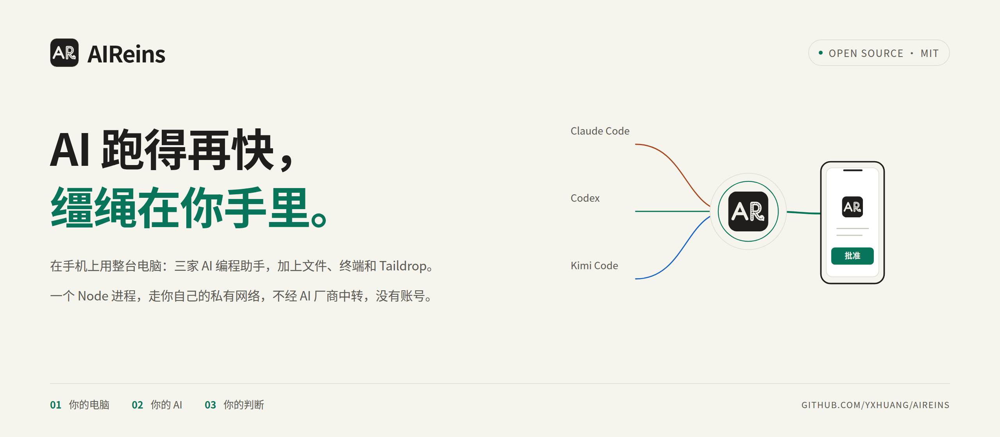
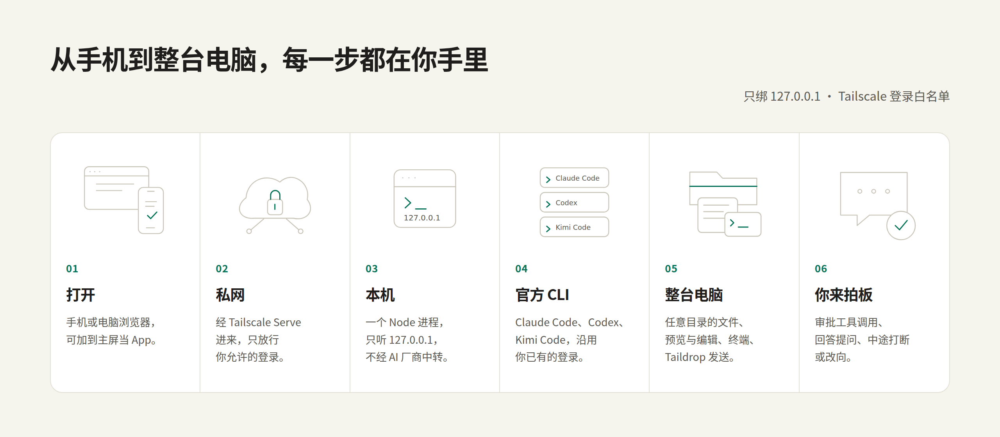

<p align="center">
  <picture>
    <source media="(prefers-color-scheme: dark)" srcset="docs/assets/banner-zh-dark.png">
    
  </picture>
</p>

<p align="center">
  <a href="LICENSE"></a>
  
  
  
  
</p>

<p align="center">
  <b>在手机上用整台电脑，让三家 AI 一起干活，方向由你来定。</b><br>
  一个 Node 进程加一个网页，走你自己的私有网络。
</p>

<p align="center">
  <a href="README.md">English</a> · <b>简体中文</b>
</p>

<p align="center">
  <a href="#跑起来">跑起来</a> ·
  <a href="#手机远程">手机远程</a> ·
  <a href="#它是怎么工作的">它是怎么工作的</a> ·
  <a href="#安全">安全</a> ·
  <a href="CONTRIBUTING.md">参与贡献</a>
</p>

<br>

## 这是什么

AIReins 是一个跑在你自己电脑上的 AI 工作台。它通过官方 CLI 驱动 Claude Code、Codex 和 Kimi Code，沿用你已有的登录；你在电脑或手机的浏览器里开会话、审批、看文件、开终端，经 [Tailscale](https://tailscale.com) 在任何地方连回这台电脑。

官方的远程方案一般只给你一个会话的窗口。AIReins 给你的是整台电脑：任意目录（包括 `/mnt/c` 下的 Windows 盘符，不限于 git 仓库）、文件预览与编辑、终端、Taildrop 发送，以及三家 CLI 的原生历史。

## 为什么叫 AIReins

Reins 是缰绳。

AI 越来越能干，能自己读代码、改文件、跑命令，一口气做完一长串事。但我不想把方向盘整个交出去：什么值得做、做到哪一步算完、哪条命令可以跑、哪个结论靠不住，这些判断应该留在人手里。

所以 AIReins 的设计都围着一件事：**AI 尽管往前跑，缰绳始终在你手里。**

- **随时随地拍板。** 工具调用在手机上批准或拒绝，AI 的提问在手机上回答；所有会话里待你处理的事集中在一处，不用一个个翻。
- **中途可以拉回来。** 一键打断；Claude Code 和 Codex 还能在运行中插话改方向、旁路追问（Kimi 运行中发的消息排到当前回合结束后），不必等它跑完再返工。
- **看得见它在做什么。** 上下文用量、每一步工具调用都摆在眼前，派出去的子代理和委派任务按父子树展开。
- **三家 AI 一起用。** 让一家当指挥、把活派给另一家（需要外部委派工具，见[可选集成](#可选集成)），你在手机上看整棵派单树；哪家适合哪件事，由你决定，不被一家绑住。
- **东西都在你自己手里。** 不经 AI 厂商中转，没有账号，没有遥测；会话就是三家 CLI 原生的历史，在命令行和 VS Code 里照样能续接。

## 说在前面

- **这是一个人为自己做的工具。** 我每天在 Windows + WSL2 上用它，项目里很大一部分代码也是在它里面、和这三家 AI 一起写出来的。它不是精心打磨的通用产品，一定还有粗糙的地方。发现问题欢迎提 Issue，我不一定能很快回复，先说声抱歉。
- **平台。** Windows + WSL2 是主力平台；原生 Linux 支持，Ubuntu CI 必过；macOS 是实验性支持，我没有 Mac，只靠 CI，欢迎 macOS 用户反馈。
- **它给的是整台电脑的权限。** 能连上 AIReins 的人，就有你这个账户在这台电脑上的全部能力。所以它只听本机回环地址，远程只走 Tailscale，并且只放行你允许的登录。请先读[安全](#安全)。
- **它不是 agent 农场。** 想在并行 worktree 里同时跑一队 agent，[Orca](https://github.com/stablyai/orca) 更合适；想在手机上用整台电脑、自己把方向，用 AIReins。

## 它是怎么工作的

<picture>
  <source media="(prefers-color-scheme: dark)" srcset="docs/assets/how-zh-dark.png">
  
</picture>

本机浏览器直连 `127.0.0.1`；其他设备先加入你的 tailnet，再经 Tailscale Serve 转发到 AIReins 的远程入口，由它做 Host/Origin 检查并只放行白名单里的 Tailscale 登录。AIReins 是一个只监听回环地址的 Node 进程，用各家官方协议驱动三家 CLI：Claude Code 的 stream-json、Codex 的 `codex app-server`、Kimi Code 的 ACP。会话写进各家 CLI 自己的历史，AIReins 只是另一个入口。协议细节见 [spikes/PROTOCOL-NOTES.md](spikes/PROTOCOL-NOTES.md)。

## 你会得到什么

| | |
|---|---|
| **三家会话** | Claude Code、Codex、Kimi Code 并排开、随时切换；每个会话单独设模型、推理档位和权限模式；斜杠命令、skills、`@` 文件提及带补全；标题自动生成，可置顶、分组、重命名 |
| **审批与提问** | 在任何设备上批准或拒绝工具调用、回答 AI 的提问；所有会话里待处理的事集中呈现 |
| **中途掌控** | 上下文用量圆环；打断；Claude Code 与 Codex 支持运行中插话改方向和旁路追问，Kimi 运行中的消息排到当前回合结束后发送 |
| **原生历史** | 搜索、按目录筛选三家 CLI 的原生历史并续接；在 AIReins 开的会话，在 CLI 和 VS Code 扩展里也能续接，反过来也一样（Codex 同一线程同一时间只能有一个客户端写入，转到别处续接前先在 AIReins 里释放） |
| **派单树** | 子代理与委派任务按父子树展开，桌面和手机都能看 |
| **整台电脑** | 文件面板浏览任意可读目录，带 Git 状态与标签页；在家目录、Windows 盘符和会话目录里预览 Markdown、代码、图片、PDF，就地编辑 1 MiB 以内的 UTF-8 文本文件；多标签终端（远程入口默认关闭，需显式开启） |
| **手机与发送** | 手机布局可加到主屏当 App；Taildrop 把文件或文件夹（打包 zip）发到你在线的设备 |
| **多台电脑** | 列出 tailnet 里的其他电脑，一键添加，在一个菜单里切换到它们的 AIReins |
| **Windows 体验** | 托盘图标和开始菜单快捷方式，以独立应用窗口打开 |
| **中英双语** | 界面跟随浏览器语言，可在「设置 → 外观」切换 |

## 看一眼

<picture>
  <source media="(prefers-color-scheme: dark)" srcset="docs/assets/shots-zh-dark.png">
  
</picture>

<p align="center"><sub>截图来自用演示数据跑起来的本地实例，里面的会话和路径都是编的。</sub></p>

## 和其他方案的区别

| | AIReins | Orca | Claude Code Remote Control | Codex Remote |
|---|---|---|---|---|
| 远程控制的对象 | 整台电脑：会话、任意目录、文件、终端 | 工作区/worktree、代理会话、终端、git | 单个 Claude Code 会话 | 一台主机上的 Codex 任务 |
| 代理 | Claude Code、Codex、Kimi | 一个 PTY 中的多种 CLI | Claude Code | Codex |
| 网络路径 | 仅你的 tailnet，无 AIReins 或 AI 厂商中转（Tailscale 直连不通时可能经其加密的 DERP 中继） | 默认走 Orca 中继（账号）；可选局域网或 Tailscale | Anthropic 中继 | OpenAI 中继 |
| 手机客户端 | Web 应用 | iOS / Android 应用（beta） | Claude 应用 | ChatGPT 应用 |
| 运行形态 | 一个 Node 进程 + 浏览器 | 桌面应用（必须保持打开） | 你的终端（必须保持打开） | 桌面应用 |
| 适合 | 一个人从任何地方用自己的一台电脑 | 在并行 worktree 中跑多个代理 | 快速查看单个会话 | 在 ChatGPT 应用中的 Codex 用户 |

<!-- Comparison facts collected 2026-10-12; re-check before each release. -->

## 跑起来

### 平台支持

| 平台 | 状态 |
|---|---|
| Windows 11 + WSL2 (Ubuntu) | 支持：安装器、托盘、应用窗口、远程网关 |
| 原生 Linux | 支持；Ubuntu CI 为必过门禁 |
| macOS | 实验性；仅 CI 覆盖，作者无实机 |
| 原生 Windows（无 WSL） | 暂无计划 |

### Windows + WSL2

依赖要求：

| 依赖 | 说明 |
|---|---|
| Node.js ≥ 22.12（含 npm） | 必需 |
| `ss`（iproute2）、`rg`（ripgrep） | 必需 |
| `zip` | 用 Taildrop 发送文件夹时需要 |
| `curl`、`python3` | 可选，用于完整的 `aireins status` 输出 |
| Claude Code、Codex 或 Kimi Code CLI | 至少一个，已安装并登录 |
| Windows 上的 Google Chrome | 用于应用窗口 |
| Windows 上的 Tailscale | 可选，用于远程访问 |

```bash
git clone https://github.com/yxhuang/AIReins.git && cd AIReins && bash install.sh
```

`install.sh` 会检查依赖、安装 npm 包、构建前端、安装 `aireins` 命令、Windows 托盘图标和开始菜单快捷方式，并跑一次冒烟测试。`git pull` 后再运行一次即可更新。`bash install.sh --check` 只报告状态，不做任何改动。

请自行从开始菜单把 "AIReins" 固定到任务栏；Windows 没有可靠的编程方式来做到这一点。

日常使用：

```bash
aireins            # 后台启动并在默认 Windows 浏览器中打开
aireins status     # 还有：aireins stop | aireins restart | aireins logs
```

AIReins 监听 `http://127.0.0.1:8790`（可用 `WORKBENCH_PORT` 修改）。托盘图标和开始菜单快捷方式会以 Chrome 应用窗口打开它。

### 原生 Linux / macOS（实验性）

使用相同的 clone 和 `bash install.sh` 命令。原生 Linux 需要 Node ≥ 22.12、npm、`ss`（iproute2）与 `rg`；macOS 用 `lsof` 查询端口，还需 `rg`（例如 `brew install ripgrep`）。`aireins` 在 Linux 调用 `xdg-open`，macOS 调用 `open`；无桌面环境可设 `WORKBENCH_NO_OPEN=1`。这些平台不安装 Windows 托盘或网关，界面隐藏 Chrome App 窗口、Windows 选择窗口、盘符转换和 PowerShell。Linux 的 systemd 部署是可选项，见[主机设置](docs/host-connections.md)。

WSL2 是作者日常使用的主力平台。Ubuntu CI 为必过门禁，macOS CI 允许实验性失败；作者没有 Mac，macOS 只在 CI 中测试。macOS 支持文件浏览与预览，安全目录 fd 操作未实现前隐藏文件编辑与文件夹 Taildrop；普通文件 Taildrop 可用。欢迎 macOS 用户在 issue 反馈。

## 手机远程

当 Windows 上已安装并登录 Tailscale 时，`install.sh` 会配置远程访问：

1. 写入 `~/.workbench/remote.json`（仅当不存在时），其中包含你的 MagicDNS HTTPS 地址和 Tailscale 登录名。远程终端默认**关闭**。
2. 在一次 UAC 提示之后，安装一个小型 Windows 网关和 `tailscale serve`。

原生 Linux/macOS 的 Tailscale 与 AIReins 必须在同一台机器。安装器仅生成缺失的 `remote.json`（`terminal: false`）并打印命令，不修改 Tailscale 配置；请自行执行：

```bash
tailscale serve --bg http://127.0.0.1:8793
```

已有配置端口不同时用安装器打印的端口。macOS 的 PATH 找不到 CLI 时回退 `/Applications/Tailscale.app/Contents/MacOS/Tailscale`。Serve 直接指向远程 loopback 监听，不需要 Windows 网关；Host/Origin 与 Tailscale 身份白名单的严格检查三平台完全相同。远程终端仍需显式 `terminal: true`。

在手机上打开 `https://<your-computer>.<tailnet>.ts.net/`，添加到主屏幕。细节与故障排查见 [deploy/windows/REMOTE.md](deploy/windows/REMOTE.md)。如果你的浏览器使用系统代理，请把 `*.ts.net` 加入绕过列表。

## 配置

AIReins 把数据保存在 `~/.workbench`。`WORKBENCH_HOME` 可以移动服务器数据目录和原生 POSIX 远程安装器的配置目录；WSL 安装、`aireins` 日志和快照保留原有路径。它不会改变三家 CLI 的全局设置，唯一的例外是你在 AIReins 中切换的 Claude Remote Control 默认值。

环境变量：

| 变量 | 默认值 | 用途 |
|---|---|---|
| `WORKBENCH_PORT` | `8790` | 本地端口（始终绑定 `127.0.0.1`） |
| `WORKBENCH_HOME` | `~/.workbench` | 服务器数据目录 |
| `WORKBENCH_LOG` | `~/.workbench/server.log` | `aireins` 写入的日志文件 |
| `WORKBENCH_STATIC_DIR` | `frontend/dist` | 改用另一份前端构建产物 |

机器相关的选项放在 `~/.workbench/prefs.json` 中。它们不显示在界面上；编辑后需要重启 AIReins：

```json
{
  "shutdownCommand": "/home/you/.local/bin/my-shutdown",
  "claudeCodeEntrypoint": "claude-vscode",
  "directoryBrowserHome": "/home/you/projects"
}
```

| 键 | 作用 |
|---|---|
| `shutdownCommand` | 一条命令的绝对路径：不带参数运行时调度一次关机（约 60 秒），带 `abort` 取消。设置后，设置菜单中会出现关机项。 |
| `claudeCodeEntrypoint` | 设为 `"claude-vscode"` 可让 Claude 会话以 VS Code 扩展的入口身份启动。 |
| `directoryBrowserHome` | 目录浏览器「主目录」按钮跳转的位置。默认为 `$HOME`。 |

远程访问在 `~/.workbench/remote.json` 中配置；见 [server/README.md](server/README.md#访问控制)。

## 可选集成

- **delegate**：派单视图还会显示外部 `delegate` 工具写入 `~/.cache/delegate` 的运行。没有它时，视图只显示原生子代理。
- **通知**：通过 `~/.workbench/notify.json` 配置飞书（Lark）webhook。计划支持更多渠道。
- **Pages**：放在 `~/.workbench/pages/` 下的小型扩展页面和启动器链接。见 [server/README.md](server/README.md)。

## 开发

```bash
npm install
npm run server        # 后端 :8790，服务 frontend/dist
npm run dev           # Vite :5173，代理到后端
npm run build         # 构建并预压缩 frontend/dist
npm test              # 前端 + 后端回归测试
npm run typecheck && npm run typecheck:frontend
```

设计说明和 API 契约见 [server/README.md](server/README.md)、[frontend/README.md](frontend/README.md) 和 [spikes/PROTOCOL-NOTES.md](spikes/PROTOCOL-NOTES.md)（目前为中文）。提交 pull request 前请阅读 [CONTRIBUTING.md](CONTRIBUTING.md)；如果你和编码代理一起工作，请阅读 [AGENTS.md](AGENTS.md)。

## 安全

任何能访问到 AIReins 的人都拥有你在该电脑上用户账号的全部权限。让它只留在 loopback 和你的 tailnet 内；绝不要用 Funnel 或端口转发把它暴露出去。威胁模型和漏洞报告方式见 [SECURITY.md](SECURITY.md)。

## 最后

AI 会越跑越快。希望这根缰绳，能让你跑得放心一点。

## 许可证

代码使用 [MIT 许可证](LICENSE)。项目名称和 Logo、第三方品牌图标不在许可范围内；详情及本仓库不包含的内容见 [NOTICE](NOTICE)。
