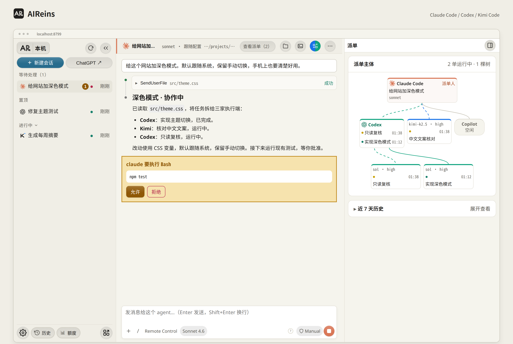
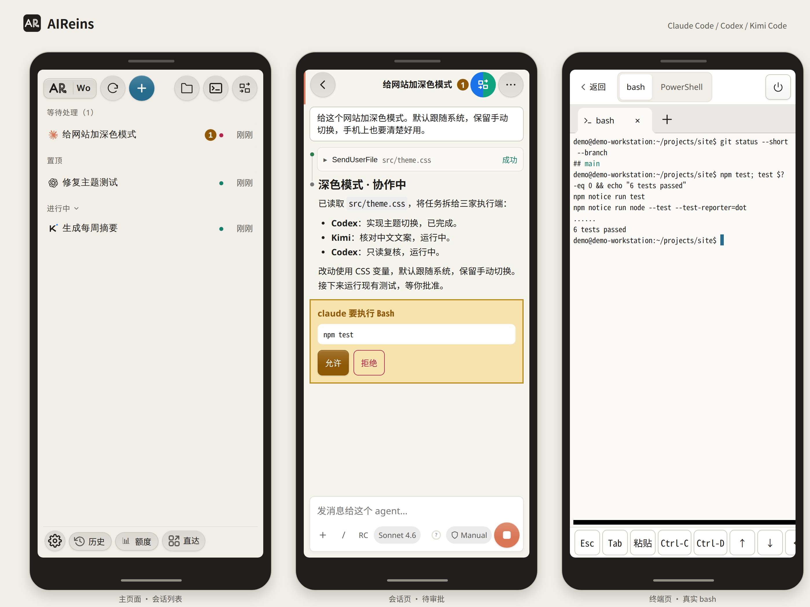

<p align="center">
  <picture>
    <source media="(prefers-color-scheme: dark)" srcset="docs/assets/banner-zh-dark.png">
    
  </picture>
</p>

<p align="center">
  <a href="LICENSE"></a>
  
  
  
  
</p>

<p align="center">
  <b>在手机上用整台电脑，让三家 AI 一起干活，方向由你来定。</b><br>
  一个 Node 进程加一个网页，走你自己的私有网络。
</p>

<p align="center">
  <a href="README.md">English</a> · <b>简体中文</b>
</p>

<p align="center">
  <a href="#跑起来">跑起来</a> ·
  <a href="#手机远程">手机远程</a> ·
  <a href="#它是怎么工作的">它是怎么工作的</a> ·
  <a href="#安全">安全</a> ·
  <a href="CONTRIBUTING.md">参与贡献</a>
</p>

<br>

## 这是什么

AIReins 是一个跑在你自己电脑上的 AI 工作台。它通过官方 CLI 驱动 Claude Code、Codex 和 Kimi Code，沿用你已有的登录；你在电脑或手机的浏览器里开会话、审批、看文件、开终端，经 [Tailscale](https://tailscale.com) 在任何地方连回这台电脑。

官方的远程方案一般只给你一个会话的窗口。AIReins 给你的是整台电脑：任意目录（包括 `/mnt/c` 下的 Windows 盘符，不限于 git 仓库）、文件预览与编辑、终端、Taildrop 发送，以及三家 CLI 的原生历史。

## 特点

- **不换掉你的 harness。** AIReins 本身不是 agent 框架，它驱动的就是你装好的 Claude Code、Codex、Kimi Code 官方 CLI。你的 `CLAUDE.md`、`AGENTS.md`、skills、hooks、MCP、插件和各家配置照常加载，不用迁移；AIReins 不会自己改写它们，只有你在界面里主动切换 Claude Remote Control 默认值或 Claude 插件开关时，才经官方 CLI 保存到对应配置。模型、推理档位和权限模式可以按会话另选，只对这个会话生效。
- **一个工作台管三家会话。** 不用在几个 CLI 窗口之间来回切：三家会话并排在侧栏，审批、回答提问、打断都在同一处。
- **历史统一看，进出都自由。** 三家的原生历史在一处搜索、按目录筛选、续接。会话本来就写在各家自己的历史里，随时可以回到 CLI、VS Code 扩展、Codex App 接着用，Claude 会话开了 Remote Control 还能在 Claude App 里连上。（Claude 会话要出现在 CLI 和 VS Code 的历史列表里，需在 `prefs.json` 设 `claudeCodeEntrypoint`，见[配置](#配置)；不设也能用 `claude --resume <会话 ID>` 续接。）
- **文件和终端就在旁边。** 右侧栏是文件窗口（浏览任意目录、预览、就地编辑、看 Git 状态）和多标签终端：Linux 与 macOS 打开你的默认 shell（`$SHELL`），WSL 下是 bash，还能开 Windows PowerShell。
- **派单拓扑实时看。** 让一家 AI 当指挥、把活派给其他家时，派单流程图实时显示谁派给了谁、跑到哪一步、成没成；子代理同样按父子树展开。
- **直达与 AI 用量。** 「直达」菜单放你自己的常用链接（网页、`vscode://`、`obsidian://` 等，改一个 JSON 文件即可）；可选内嵌 [AI-Usage](https://github.com/yxhuang/ai-usage) 面板，三家订阅额度一页看清；有固定时间窗口的额度条上还标着这个窗口的时间已过去多少，用得比时间快还是慢一眼就知道。
- **手机上也是整台电脑。** 经 Tailscale 连回，审批、看文件、开终端都能在手机上做。

## 看一眼

<picture>
  <source media="(prefers-color-scheme: dark)" srcset="docs/assets/desktop-zh-dark.png">
  
</picture>

<picture>
  <source media="(prefers-color-scheme: dark)" srcset="docs/assets/mobile-zh-dark.png">
  
</picture>

<p align="center"><sub>截图来自用演示数据跑起来的本地实例，里面的会话和路径都是编的。</sub></p>

## 为什么叫 AIReins

Reins 是缰绳。

AI 越来越能干，能自己读代码、改文件、跑命令，一口气做完一长串事。但我不想把方向盘整个交出去：什么值得做、做到哪一步算完、哪条命令可以跑、哪个结论靠不住，这些判断应该留在人手里。

所以 AIReins 的设计都围着一件事：**AI 尽管往前跑，缰绳始终在你手里。**

- **随时随地拍板。** 工具调用在手机上批准或拒绝，AI 的提问在手机上回答；所有会话里待你处理的事集中在一处，不用一个个翻。
- **中途可以拉回来。** 一键打断；Claude Code 和 Codex 还能在运行中插话改方向、旁路追问（Kimi 运行中发的消息排到当前回合结束后），不必等它跑完再返工。
- **看得见它在做什么。** 上下文用量、每一步工具调用都摆在眼前，派出去的子代理和委派任务按父子树展开。
- **三家 AI 一起用。** 让一家当指挥、把活派给另一家（需要外部委派工具，见[可选集成](#可选集成)），你在手机上看整棵派单树；哪家适合哪件事，由你决定，不被一家绑住。
- **东西都在你自己手里。** 不经 AI 厂商中转，没有账号，没有遥测；会话就是三家 CLI 原生的历史，在命令行和 VS Code 里照样能续接。

## 说在前面

- **这是一个人为自己做的工具。** 我每天在 Windows + WSL2 上用它，项目里很大一部分代码也是在它里面、和这三家 AI 一起写出来的。它不是精心打磨的通用产品，一定还有粗糙的地方。发现问题欢迎提 Issue，我不一定能很快回复，先说声抱歉。
- **平台。** Windows + WSL2 是主力平台；原生 Linux 支持，Ubuntu CI 必过；macOS 是实验性支持，我没有 Mac，只靠 CI，欢迎 macOS 用户反馈。
- **它给的是整台电脑的权限。** 能连上 AIReins 的人，就有你这个账户在这台电脑上的全部能力。所以它只听本机回环地址，远程只走 Tailscale，并且只放行你允许的登录。请先读[安全](#安全)。
- **它不是 agent 农场。** 想在并行 worktree 里同时跑一队 agent，[Orca](https://github.com/stablyai/orca) 更合适；想在手机上用整台电脑、自己把方向，用 AIReins。

## 我自己怎么用：派单协作

我的日常是“一家指挥、几家执行”：

1. **指挥。** 在 AIReins 里开一个 Claude Code 会话：理解需求、拆任务、定验收标准，最后由它验收。
2. **派单。** 执行交给更合适、也更省额度的一家：开放式实现、复杂诊断交给 Codex，边界清楚的批量活和中文核对交给 Kimi，几乎不用判断的机械活交给 GitHub Copilot。每张派单是一份自包含的工单（目标、读写范围、验收命令），由一个小脚本 `delegate` 在后台调用对应 CLI，跑完自动执行验收命令。
3. **复核。** 关键产出再交给另一家只读复核，指挥逐条核实后才采纳。
4. **掌控。** 整个过程在派单流程图里实时可见，手机上也能看；哪里卡住了、要不要拉回来，由我决定。

`delegate` 是我的个人脚本，不在本仓库里。派单视图读它写下的运行记录；没有它时，只显示各家原生的子代理。

## 它是怎么工作的

<picture>
  <source media="(prefers-color-scheme: dark)" srcset="docs/assets/how-zh-dark.png">
  
</picture>

本机浏览器直连 `127.0.0.1`；其他设备先加入你的 tailnet，再经 Tailscale Serve 转发到 AIReins 的远程入口，由它做 Host/Origin 检查并只放行白名单里的 Tailscale 登录。AIReins 是一个只监听回环地址的 Node 进程，用各家官方协议驱动三家 CLI：Claude Code 的 stream-json、Codex 的 `codex app-server`、Kimi Code 的 ACP。会话写进各家 CLI 自己的历史，AIReins 只是另一个入口。协议细节见 [spikes/PROTOCOL-NOTES.md](spikes/PROTOCOL-NOTES.md)。

## 功能一览

| | |
|---|---|
| **三家会话** | Claude Code、Codex、Kimi Code 并排开、随时切换；每个会话单独设模型、推理档位和权限模式；斜杠命令、skills、`@` 文件提及带补全；标题自动生成，可置顶、分组、重命名 |
| **审批与提问** | 在任何设备上批准或拒绝工具调用、回答 AI 的提问；所有会话里待处理的事集中呈现 |
| **中途掌控** | 上下文用量圆环；打断；Claude Code 与 Codex 支持运行中插话改方向和旁路追问，Kimi 运行中的消息排到当前回合结束后发送 |
| **原生历史** | 搜索、按目录筛选三家 CLI 的原生历史并续接；在 AIReins 开的会话，在 CLI 和 VS Code 扩展里也能续接（Claude 会话要出现在历史列表里需设 `claudeCodeEntrypoint`），反过来也一样（Codex 同一线程同一时间只能有一个客户端写入，转到别处续接前先在 AIReins 里释放） |
| **派单树** | 子代理与委派任务按父子树展开，派单流程图实时显示状态，桌面和手机都能看 |
| **直达与扩展页** | 「直达」菜单读 `~/.workbench/pages/links.json` 里你自己的链接；扩展页可嵌入 [AI-Usage](https://github.com/yxhuang/ai-usage) 等本地小工具 |
| **整台电脑** | 文件面板浏览任意可读目录，带 Git 状态与标签页；在家目录、Windows 盘符和会话目录里预览 Markdown、代码、图片、PDF，就地编辑 UTF-8 文本文件（超过 4 MiB 先确认再加载，上限 32 MiB）；多标签终端（远程入口默认关闭，需显式开启） |
| **手机与发送** | 手机布局可加到主屏当 App；Taildrop 把文件或文件夹（打包 zip）发到你在线的设备 |
| **多台电脑** | 列出 tailnet 里的其他电脑，一键添加，在一个菜单里切换到它们的 AIReins |
| **Windows 体验** | 托盘图标和开始菜单快捷方式，以独立应用窗口打开 |
| **中英双语** | 界面跟随浏览器语言，可在「设置 → 外观」切换 |

## 和其他方案的区别

| | AIReins | Orca | Claude Code Remote Control | Codex Remote |
|---|---|---|---|---|
| 远程控制的对象 | 整台电脑：会话、任意目录、文件、终端 | 工作区/worktree、代理会话、终端、git | 单个 Claude Code 会话 | 一台主机上的 Codex 任务 |
| 代理 | Claude Code、Codex、Kimi | 一个 PTY 中的多种 CLI | Claude Code | Codex |
| 网络路径 | 仅你的 tailnet，无 AIReins 或 AI 厂商中转（Tailscale 直连不通时可能经其加密的 DERP 中继） | 默认走 Orca 中继（账号）；可选局域网或 Tailscale | Anthropic 中继 | OpenAI 中继 |
| 手机客户端 | Web 应用 | iOS / Android 应用（beta） | Claude 应用 | ChatGPT 应用 |
| 运行形态 | 一个 Node 进程 + 浏览器 | 桌面应用（必须保持打开） | 你的终端（必须保持打开） | 桌面应用 |
| 适合 | 一个人从任何地方用自己的一台电脑 | 在并行 worktree 中跑多个代理 | 快速查看单个会话 | 在 ChatGPT 应用中的 Codex 用户 |

<!-- Comparison facts collected 2026-10-12; re-check before each release. -->

## 跑起来

### 平台支持

| 平台 | 状态 |
|---|---|
| Windows 11 + WSL2 (Ubuntu) | 支持：安装器、托盘、应用窗口、远程网关 |
| 原生 Linux | 支持；Ubuntu CI 为必过门禁 |
| macOS | 实验性；仅 CI 覆盖，作者无实机 |
| 原生 Windows（无 WSL） | 暂无计划 |

### 第一步：先准备好这些

| | Windows + WSL2 | 原生 Linux | macOS |
|---|---|---|---|
| Node.js ≥ 22.12（含 npm） | 在 WSL 里装 | 自己装 | 有 Homebrew 时安装器可代装 |
| `rg`（ripgrep） | `sudo apt-get install -y ripgrep` | 同左 | 有 Homebrew 时安装器可代装 |
| 端口检测 | `ss`（iproute2） | `ss`（iproute2） | 系统自带 `lsof` |
| 至少一家 AI CLI | Claude Code、Codex 或 Kimi Code，已安装并登录 | 同左 | 同左 |
| 远程访问（可选） | Windows 上的 Tailscale，已登录 | 本机 Tailscale，已登录 | 本机 Tailscale，已登录 |
| 其他 | Windows 上的 Google Chrome（应用窗口用） | | |

`curl` 和 `python3`（`aireins status` 的完整输出）是可选的；用 Taildrop 发文件夹还需要自己装 `zip`（安装器不检查它）。Node、npm、`rg`、端口工具缺了，安装器会指出来并给出修复提示；AI CLI 只检查装没装，登录状态要你自己确认。

### 第二步：一条命令安装

三个平台都一样：

```bash
git clone https://github.com/yxhuang/AIReins.git && cd AIReins && bash install.sh
```

安装器会**自动**做这些事：

1. **体检**：检查 Node、npm、端口工具、`rg` 和三家 CLI。缺核心依赖就停下，并打印对应平台的修复命令。在 macOS 上，如果装了 Homebrew 且是在交互终端里运行，它会问一次 `[Y/n]`，回车后替你 `brew install` 缺的 Node 或 ripgrep，装完再检查一遍。Linux 上需要 `sudo` 的命令只打印，不替你执行。
2. **安装与构建**：安装 npm 依赖，构建前端。
3. **装 `aireins` 命令**：链接到 `~/.local/bin/aireins`。
4. **WSL：装 Windows 托盘和开始菜单快捷方式**（不依赖 Tailscale；装完不自动启动托盘）。
5. **配远程入口**（本机 Tailscale 已登录时）：生成 `~/.workbench/remote.json`（已有的不覆盖；远程终端默认关闭；新文件的远程端口默认 8793）。之后：
   - **WSL**：Windows 远程网关任务还没装时，经一次 UAC 确认装好网关和 `tailscale serve`；已装过就跳过。
   - **原生 Linux / macOS**：Tailscale Serve 还没配置任何东西时，自动执行 `tailscale serve --bg http://127.0.0.1:<remote.json 里的端口>`；已经指向 AIReins 就保持不动；有别的配置就**不覆盖**，打印现状和要手动执行的命令。Linux 上如果提示权限不够，按提示执行一次 `sudo tailscale set --operator="$USER"`，再重跑 `bash install.sh`。
6. **冒烟测试**：确认接口、首页和静态资源都正常。AIReins 已在运行就直接检查它；没运行就临时启动一次，查完再停掉。

你还需要**手动**做的：

- 安装并登录至少一家 AI CLI；要远程访问，再安装并登录 Tailscale。安装器不碰你的账号和三家 CLI 的配置。
- 安装器提示 `~/.local/bin` 不在 PATH 时，把它打印的那一行加进 shell 配置（macOS 一般是 `~/.zshrc`，Linux/WSL 是 `~/.bashrc`），再重开终端。
- **WSL**：从开始菜单打开「AIReins」启动托盘，并把它固定到任务栏（Windows 不允许程序替你固定）。
- 安装器报告远程配置失败（比如拒绝了 UAC、Serve 已有别的配置）时，按它的提示处理后重跑 `bash install.sh`。
- 开机或登录自启目前要你自己配置。原生 Linux 上，仓库里的 systemd 单元可以做到“远程有人连进来时再启动 AIReins”，但需要把 Serve 改指到 8792，见[主机设置](docs/host-connections.md)。

### 第三步：日常使用

```bash
aireins            # 后台启动并在浏览器中打开
aireins status     # 还有：aireins stop | aireins restart | aireins logs
```

AIReins 监听 `http://127.0.0.1:8790`（可用 `WORKBENCH_PORT` 修改）。Windows 上点托盘图标或开始菜单快捷方式，会以 Chrome 应用窗口打开；Linux 用 `xdg-open`、macOS 用 `open` 打开默认浏览器；没有桌面环境时设 `WORKBENCH_NO_OPEN=1`。

**更新**：`git pull && bash install.sh`，然后择时 `aireins restart`（会中断正在运行的会话）。**只体检不改动**：`bash install.sh --check`。

**平台差异**：原生 Linux 和 macOS 没有托盘、应用窗口、Windows 目录选择窗口和 PowerShell；终端用 AIReins 服务进程的 `$SHELL`（须是可执行的绝对路径，且在 `/etc/shells` 存在时列于其中）；不合格时 macOS 依次退回 `/bin/zsh`、bash，Linux 退回 bash。macOS 暂时只能浏览和预览文件，不能就地编辑，也不能用 Taildrop 发文件夹（单个文件可以）。作者没有 Mac，macOS 只在 CI 里测过，欢迎在 issue 里反馈。

## 手机远程

安装器报告远程入口配置成功、AIReins 也在运行后，在手机上：

1. 装 Tailscale，用同一个账号登录，加入你的 tailnet。
2. 打开 `https://<你的电脑名>.<tailnet>.ts.net/`，然后「添加到主屏幕」，就能像 App 一样打开。

几点说明：

- 只有 `remote.json` 里 `allowedLogins` 列出的 Tailscale 登录能进来。远程入口的 Host/Origin 和身份检查，三个平台完全一样。
- 远程终端默认关闭；需要时在 `remote.json` 里设 `"terminal": true`，再 `aireins restart`。
- 安装时 AIReins 已经在运行的话，要 `aireins restart` 一次，新的远程配置才生效。
- 浏览器走系统代理的话，把 `*.ts.net` 加进绕过列表。
- 细节与故障排查见 [deploy/windows/REMOTE.md](deploy/windows/REMOTE.md) 和 [docs/host-connections.md](docs/host-connections.md)。

## 配置

AIReins 把数据保存在 `~/.workbench`。`WORKBENCH_HOME` 可以移动服务器数据目录和原生 POSIX 远程安装器的配置目录；WSL 安装、`aireins` 日志和快照保留原有路径。它不会自己改变三家 CLI 的设置；只有你在 AIReins 里主动切换 Claude Remote Control 默认值或 Claude 插件开关时，才会保存到对应的原生配置（插件经官方 `claude plugin enable/disable`）。

环境变量：

| 变量 | 默认值 | 用途 |
|---|---|---|
| `WORKBENCH_PORT` | `8790` | 本地端口（始终绑定 `127.0.0.1`） |
| `WORKBENCH_HOME` | `~/.workbench` | 服务器数据目录 |
| `WORKBENCH_LOG` | `~/.workbench/server.log` | `aireins` 写入的日志文件 |
| `WORKBENCH_STATIC_DIR` | `frontend/dist` | 改用另一份前端构建产物 |

机器相关的选项放在 `~/.workbench/prefs.json` 中。它们不显示在界面上；编辑后需要重启 AIReins：

```json
{
  "shutdownCommand": "/home/you/.local/bin/my-shutdown",
  "claudeCodeEntrypoint": "claude-vscode",
  "directoryBrowserHome": "/home/you/projects"
}
```

| 键 | 作用 |
|---|---|
| `shutdownCommand` | 一条命令的绝对路径：不带参数运行时调度一次关机（约 60 秒），带 `abort` 取消。设置后，设置菜单中会出现关机项。 |
| `claudeCodeEntrypoint` | 设为 `"claude-vscode"` 可让 Claude 会话以 VS Code 扩展的入口身份启动，这样新会话会出现在 `claude --resume` 和 VS Code 扩展的历史列表里（不设时只能按会话 ID 续接）。 |
| `directoryBrowserHome` | 目录浏览器「主目录」按钮跳转的位置。默认为 `$HOME`。 |

远程访问在 `~/.workbench/remote.json` 中配置；见 [server/README.md](server/README.md#访问控制)。

## 可选集成

- **delegate**：派单视图还会显示外部 `delegate` 工具写入 `~/.cache/delegate` 的运行（用法见[我自己怎么用](#我自己怎么用派单协作)）。没有它时，视图只显示原生子代理。
- **AI-Usage**：[ai-usage](https://github.com/yxhuang/ai-usage) 是另一个独立的本地小工具，读本机已有凭据显示三家订阅额度。按它的 README 装好并启动（默认 `127.0.0.1:8788`），再新建 `~/.workbench/pages/ai-usage/manifest.json` 并重启 AIReins，侧栏底部的「额度」按钮就会在 AIReins 里打开它（`proxy: true` 让手机远程也能看）：

  ```json
  {"id":"ai-usage","name":"AI-Usage","icon":"📊","type":"iframe","url":"http://127.0.0.1:8788","proxy":true}
  ```

- **直达链接**：在 `~/.workbench/pages/links.json` 写入你的链接，刷新页面或重新打开「直达」即生效，`group` 用来分组：

  ```json
  {"links":[{"name":"GitHub","url":"https://github.com","icon":"🐙","group":"常用"},{"name":"笔记","url":"obsidian://open?vault=notes","icon":"📝","group":"常用"}]}
  ```
- **通知**：通过 `~/.workbench/notify.json` 配置飞书（Lark）webhook。计划支持更多渠道。
- **Pages**：`~/.workbench/pages/` 下每个子目录一个扩展页面（字段见 [server/README.md](server/README.md#pages-扩展页面)）。

## 开发

```bash
npm install
npm run server        # 后端 :8790，服务 frontend/dist
npm run dev           # Vite :5173，代理到后端
npm run build         # 构建并预压缩 frontend/dist
npm test              # 前端 + 后端回归测试
npm run typecheck && npm run typecheck:frontend
```

设计说明和 API 契约见 [server/README.md](server/README.md)、[frontend/README.md](frontend/README.md) 和 [spikes/PROTOCOL-NOTES.md](spikes/PROTOCOL-NOTES.md)（目前为中文）。提交 pull request 前请阅读 [CONTRIBUTING.md](CONTRIBUTING.md)；如果你和编码代理一起工作，请阅读 [AGENTS.md](AGENTS.md)。

## 安全

任何能访问到 AIReins 的人都拥有你在该电脑上用户账号的全部权限。让它只留在 loopback 和你的 tailnet 内；绝不要用 Funnel 或端口转发把它暴露出去。威胁模型和漏洞报告方式见 [SECURITY.md](SECURITY.md)。

## 最后

AI 会越跑越快。希望这根缰绳，能让你跑得放心一点。

## 许可证

代码使用 [MIT 许可证](LICENSE)。项目名称和 Logo、第三方品牌图标不在许可范围内；详情及本仓库不包含的内容见 [NOTICE](NOTICE)。
